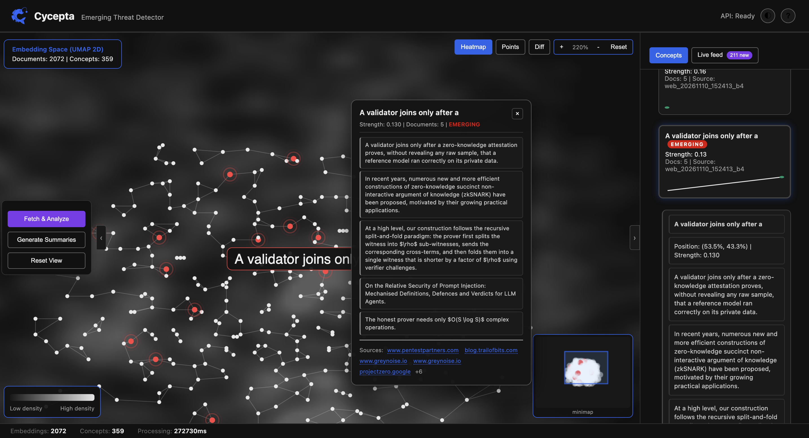

<div align="center">


# Cycepta

<em>An Emerging-Threat Detector for the Cybersecurity News Stream</em>

Fetches security news and CVE feeds, embeds them, clusters concepts in a UMAP
space, and surfaces emerging threats on an interactive map — with one
LLM-generated Markdown report and lead time relative to CISA KEV.

</div>

> [!WARNING]
> **Project status: active development.** Cycepta is a research prototype,
> not a production security product. Expect bugs, incomplete features and
> rough edges; APIs, configuration and behaviour may change without notice.
> Validate every finding and generated report before acting on it.

## ⚡ Overview

**Cycepta** is a local-first emerging-threat detection system. Every period it
ingests 60+ curated RSS security sources (plus NVD/KEV data), turns the documents into
concept clusters, and compares the new period against the retained history to
answer a single question: **what broke out just now, before it hits CISA KEV?**

> You only need to: run one command and point it at the public feeds</br>
> Cycepta will return: an interactive concept map, a live event feed and
> one Markdown security report across all concepts

- **New-concept detection**: cross-period graph over `blob_log` clusters plus
  k-NN novelty and a burst tier; fully deterministic (fit-once UMAP, seed 42,
  content-addressed concept ids — two replays of the same stream produce the
  same entities).
- **Dashboard**: concept map with heatmap/diff views, live event feed
  (SignalR), one-click Markdown report, member-document source links.
- **Local LLM**: `ibm-granite/granite-4.0-1b` runs on-device via HF
  Transformers (`mlx` stays an Apple opt-in; API providers are supported).
- **Deterministic baseline**: wall-clock dev **0.6955** / test **0.6403**
  on the real NVD/KEV stream (mean lead ~0.87).

| Process | Stack | Port | Role |
|---------|-------|------|------|
| NCD | Python (FastAPI) | `8080` (in container) / `5000` locally | Engine: embeddings, UMAP, clustering, report summaries |
| API | .NET (ASP.NET) | `5001` | HTTP API, RSS/NVD parsing, SQLite, SignalR, dashboard |

## 📸 Screenshots

<div align="center">
<table>
<tr>
<td></td>
</tr>
<tr><i>Dashboard on a live RSS stream: concept map with newly emerging concepts
highlighted in red.</i></tr>
</table>
</div>

## ✨ Features

### Detection engine (NCD)
- **Ingest 60+ security sources in one click** — government advisories,
  vendor research, independent reporting, AppSec/DFIR blogs and academic
  feeds, plus NVD/CVE data, with per-source caps, a private-host (SSRF)
  guard, redirect protection and HTML-entity cleanup. Every feed gets its
  own timeout inside a wider fetch budget; documents are selected round-robin
  with a fair-share quota, so one giant feed cannot crowd the rest out.
  `/api/v1/sources` reports the last status and document count for each feed.
- **Emerging-concept detection** — `blob_log` density clustering over the
  UMAP space combined with block-wise k-NN novelty in the raw 768-dim
  embedding space and an adaptive familiarity floor.
- **Burst tier (N1.2)** — a second clustering pass over the residual
  novelty pool that surfaces out-of-nowhere concepts skipping the usual
  growth/recurrence gate, plus an inflow gate that ignores generic waffle.
- **Cross-period concept tracking** — concepts are matched against history
  through a cross-period graph with content-addressed, deterministic
  concept IDs (two replays of the same stream produce identical entities).
- **Lead-time measurement** — every concept is scored for how early it
  emerges relative to CISA KEV; `benchmark/score.py` reproduces the
  dev (0.6955) / test (0.6403) regression numbers.

### Dashboard
- **Interactive concept map** — heatmap / points / diff view modes over the
  UMAP projection, zoom controls and a minimap for orientation.
- **Concept details on click** — member documents, original source links,
  strength history and emerging flags per concept.
- **Live event feed** — period events, new-document and concept pushes over
  SignalR with a "new items" badge.
- **One-button analysis** — "Fetch & Analyze" runs ingest → embed → cluster →
  compare period in memory-safe batches; concepts appear on the heatmap and
  in the live feed as each batch finishes, before the run completes.
  "Generate Summaries" builds one Markdown security report for the whole
  concept set.
- **Light/dark/system theme** (System by default, follows the OS setting),
  onboarding tour, pinned details panel. Press **A** or **D** to hide/show
  the left or right panel.

### LLM layer
- **On-device item summaries** — `ibm-granite/granite-4.0-1b` runs locally
  through HF Transformers by default (`mlx` remains Apple opt-in, `none`
  disables generation). The model shortens report items in memory-safe
  batches; IOC, severity and MITRE extraction stay deterministic.
- **Reasoning trace in the UI** — if a model emits a think-block, it is
  returned separately and the dashboard shows it in a collapsible "Model
  reasoning" panel; Granite answers directly and the panel stays hidden.
- **Summarization profile** — 4K prompt window, 1024-token output ceiling,
  temperature 0.3 by default (`0` = greedy) and a light repetition penalty.
  The report layer caps item batches at 8 so prompts stay near 1K tokens on
  8 GB machines. bfloat16 on accelerators, float32 on CPU, OOM retry at half
  the token budget, and opt-in 4-bit weights via `NCD_LLM_QUANT=int4`.
- **Bring-your-own API** — OpenAI-compatible providers (OpenAI, Groq,
  OpenRouter, vLLM) and Anthropic's Messages API can be registered in
  `ncdbody/llm_providers.yaml`; the dashboard shows a chooser of available
  backends before summarization. Anthropic uses `format: anthropic`; everything
  else defaults to the OpenAI `/chat/completions` shape.

### HTTP API
- REST endpoints: `POST /api/v1/analyze/fetch-and-analyze`,
  `POST /api/v1/analyze/summarize`, `GET /api/v1/analyze/llm-providers`,
  `GET /api/v1/concepts[/{id}][/history]`, `GET /api/v1/concepts/periods`,
  `GET/POST /api/v1/sources`, `POST /api/v1/ingest` (optional
  `X-API-Key`), `/health`.
- Live push over SignalR for the feed and map updates.

### Operations
- **Deterministic by design** — fit-once UMAP (seed 42), pinned eval
  matrices, stable concept IDs; reproducible replays.
- **SQLite storage with WAL** — incremental concepts, documents, periods
  and events; survives restarts and feeds the dashboard history.
- **Hardened deployment** — loopback-only binds, unprivileged container
  user, health checks for both processes, batching and backpressure
  between API and engine, `.env`-driven configuration, Docker Compose.
- **Tested** — .NET, Python and JS suites plus a CI pipeline and a
  release-gate checklist (`TESTING.md`).

## 🔄 Workflow

1. **Ingest**: RSS + NVD fetching with an SSRF guard, per-source caps and
   HTML-entity cleanup
2. **Embed**: sentence-transformer embeddings with a local model cache
3. **Cluster**: UMAP projection (fit-once, deterministic) + `blob_log`
   clustering + burst/novelty tiers
4. **Compare**: cross-period graph matching against history with
   content-addressed concept IDs
5. **Report**: one Markdown security report (local Granite 4.0 1B or
   OpenAI-compatible API), live push to the dashboard over SignalR

## 🚀 Quick Start

### Option 1: Docker Deployment (Recommended)

```bash
# one command
docker compose up --build -d
# dashboard: http://localhost:5001/  (first start ~3-15 min — model download)
```

Reads `.env` from the project root; the container runs as an unprivileged
user and health-checks both processes.

### Option 2: Source Code Deployment

#### Prerequisites

| Tool | Version | Description | Check Installation |
|------|---------|-------------|-------------------|
| **.NET SDK** | 10.0 | API + dashboard | `dotnet --version` |
| **Python** | 3.10–3.12 (3.12 recommended) | NCD engine; 3.13 is not supported by the pinned wheels | `python3 --version` |
| **uv** | Latest (optional) | Faster manual Python env; `setup.sh` uses `venv` + `pip` | `uv --version` |

#### 1. Configure Environment Variables

```bash
cp env.example .env    # ports, engine knobs, LLM selection + keys
```

The defaults are sane for a first run. The Granite 4.0 1B weights
(~3.3 GB, gated — accept the IBM license and log in with `hf auth login`)
are optional and are not bundled; download them separately to enable local
LLM summaries (otherwise reports use the deterministic fallback):

```bash
hf download ibm-granite/granite-4.0-1b \
  --local-dir ncdbody/models/granite-4.0-1b
```

#### 2. Install Dependencies

```bash
bash setup.sh   # repo-root .venv + Python deps + NuGet restore (once)
```

#### 3. Start Services

```bash
bash run.sh     # both services
```

**Service URLs:**
- Dashboard: `http://localhost:5001/`
- NCD engine API: `http://localhost:5000/`

## 🔐 Secure by default

- Everything binds to `127.0.0.1:5000-5001` / loopback inside the container;
  external access goes through an authenticating reverse proxy (the
  dashboard has no built-in auth).
- The container runs as the unprivileged `app` user; health checks cover
  both processes.
- LLM endpoints are restricted to the `ncdbody/llm_providers.yaml` registry;
  RSS feeds are protected against private hosts and redirects.
- Optional `X-API-Key` for `/api/v1/ingest` (`THREAT_INGEST_KEY`).

## 📈 Checks and Metrics

```bash
bash scripts/test.sh                     # fast checks (seconds)
python3 benchmark/score.py --split dev   # synthetic detection regression check
```

Wall-clock metrics on the real NVD/KEV stream (dev 0.6955 / test 0.6403):
running and re-baselining — [TESTING.md](TESTING.md); models, NVIDIA/CUDA,
all environment variables and troubleshooting — [QUICK_START.md](QUICK_START.md).

<table>
<tr>
<th>Environment Variable</th><th>Default</th><th>Description</th>
</tr>
<tr><td><code>NCD_LLM_MODEL</code></td><td><code>models/granite-4.0-1b</code></td><td>Local LLM path relative to <code>ncdbody/</code> (empty = heuristics only)</td></tr>
<tr><td><code>NCD_LLM_BACKEND</code></td><td><code>transformers</code></td><td><code>transformers</code> · <code>mlx</code> (Apple opt-in) · <code>none</code></td></tr>
<tr><td><code>NCD_LLM_CTX</code> / <code>NCD_LLM_MAX_TOKENS</code></td><td><code>4096</code> / <code>1024</code></td><td>Prompt window and output ceiling for memory-safe item-summary batches</td></tr>
<tr><td><code>NCD_LLM_TEMPERATURE</code></td><td><code>0.3</code></td><td>Sampling temperature for item summaries; <code>0</code> = greedy, reproducible</td></tr>
<tr><td><code>OPENAI_API_KEY</code> / <code>GROQ_API_KEY</code> / <code>OPENROUTER_API_KEY</code> / <code>ANTHROPIC_API_KEY</code></td><td>—</td><td>Optional keys for the API providers in <code>ncdbody/llm_providers.yaml</code>; keys are read from the environment or entered per request and are never stored</td></tr>
<tr><td><code>THREAT_INGEST_KEY</code></td><td>—</td><td>Optional <code>X-API-Key</code> for the ingest endpoint</td></tr>
<tr><td><code>Ingest__AnalysisChunkSize</code></td><td><code>250</code></td><td>Documents per NCD batch during Fetch &amp; Analyze; concepts are pushed after each batch</td></tr>
<tr><td><code>NcdService__TimeoutSeconds</code></td><td><code>300</code></td><td>Per-batch NCD timeout; the whole interactive run is not time-limited</td></tr>
<tr><td><code>Ingest__FeedTimeoutSeconds</code></td><td><code>15</code></td><td>Per-feed timeout; one slow host cannot cancel the rest of the source list</td></tr>
<tr><td><code>Ingest__FeedBudgetSeconds</code></td><td><code>120</code></td><td>Wall-clock budget for the whole RSS fetch; unfinished feeds are retried on the next run</td></tr>
<tr><td><code>Ingest__FeedConcurrency</code></td><td><code>12</code></td><td>Maximum feed hosts fetched in parallel</td></tr>
</table>

## 📄 Data

`stream/data/` (the CVE stream, KEV, the embedding cache) is generated
locally from public sources by the `stream/` scripts and is deliberately
not committed; the repository contains code only.
